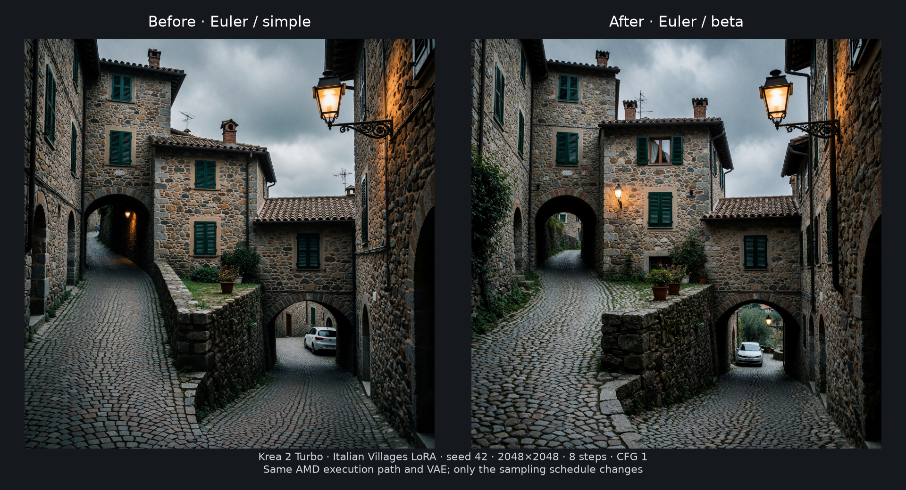
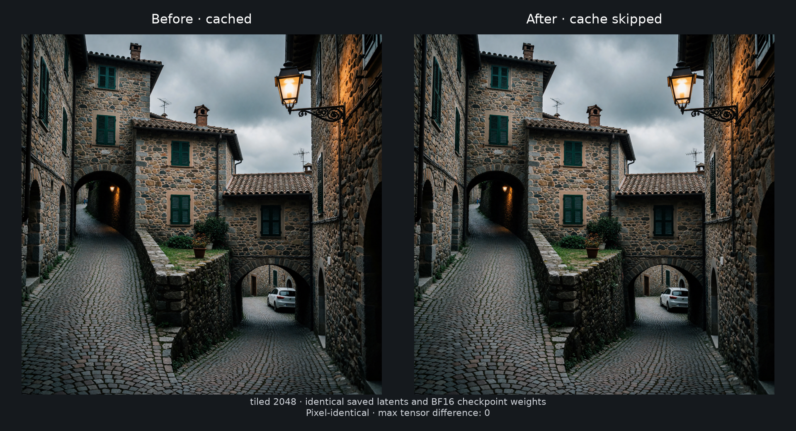
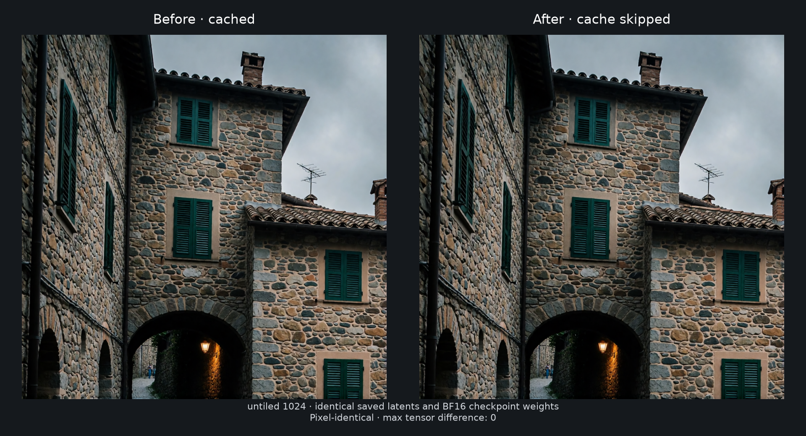

# Krea 2 PR comparisons

Comparison images for the ROCm memory and single-frame VAE PRs. This branch contains review evidence only.

## Settings

RX 9070 XT / gfx1201, seed 42, 2048×2048, 8 steps, CFG 1, Euler, stored FP8 Krea2 Turbo DiT, FP8 Qwen3-VL 4B text encoder, BF16 Qwen-Image VAE, SageAttention.

LoRA: `V67_Italian_Villages_epoch_1.safetensors`, default strength, no donor or slider changes.
LoRA SHA-256: `6952d4df730524f37b42ceff079c4e1383c34e419494379dad1e71288676d360`.

Prompt:

> A moody, cinematic photograph of a narrow cobblestone street splitting into two diverging paths in a historic European stone village. The left path curves uphill through a dark, tunnel-like stone archway, while the right path descends under a low archway where a white car is parked. Ancient, textured stone buildings with green wooden shutters surround the alleys. A warm, glowing vintage street lantern hangs overhead, contrasting beautifully with the overcast, cloudy sky. Realistic, atmospheric lighting, highly detailed, architectural photography.

## Scheduler

Left: simple. Right: beta. Both recipes used the same revised AMD execution path, precision and VAE. Only the schedule changes. Simple remains the preferred default for this workflow; beta was reverted and is retained here for discussion. This one-seed pair does not establish general quality superiority.

## VAE

Left: existing temporal caching. Right: skip unused caches for a single frame. Both use identical saved latents and BF16 checkpoint weights. Full 2048×2048 tiled decoding and 1024×1024 untiled decoding (a latent crop) produced exactly identical tensors and byte pixels. Tiled and untiled 1024×1024 encoding also produced identical posterior parameters. The causal-convolution slicing shortcut was excluded.

Peak Torch allocated VRAM, before → after:

| Operation | Before | After |
| --- | ---: | ---: |
| Untiled 1024 decode | 8.76 GiB | 6.70 GiB |
| Tiled 2048 decode | 0.89 GiB | 0.76 GiB |

These figures exclude allocator caches and driver memory. VAE-only validation used a 1 GiB extra allocator reserve. NVIDIA hardware was not tested. No kernel GPU faults were logged. Timings are single-pass and affected by warmup; no speed claim is made.
